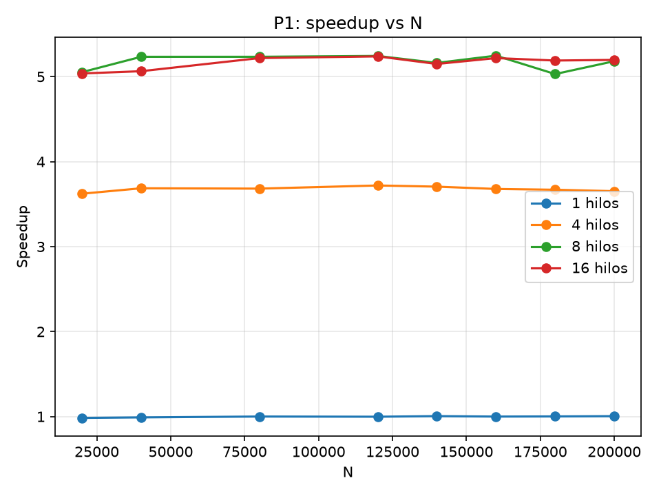
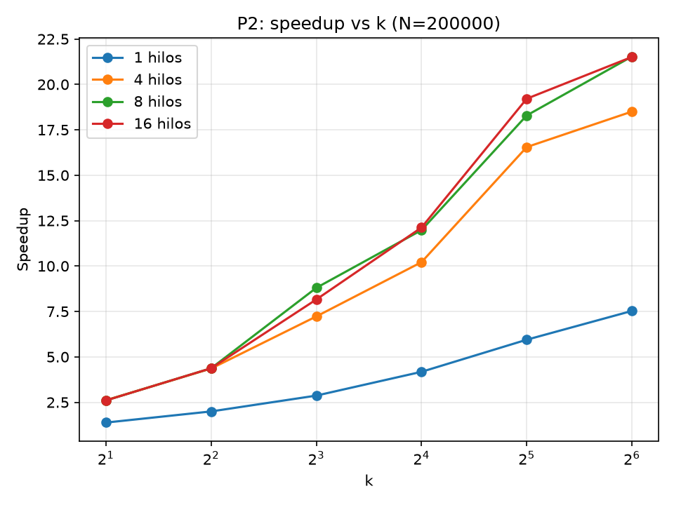
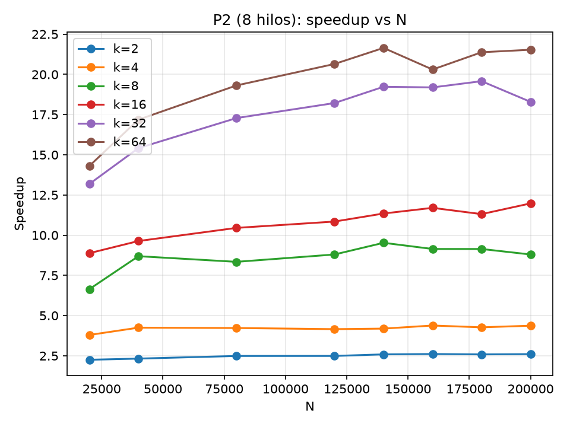
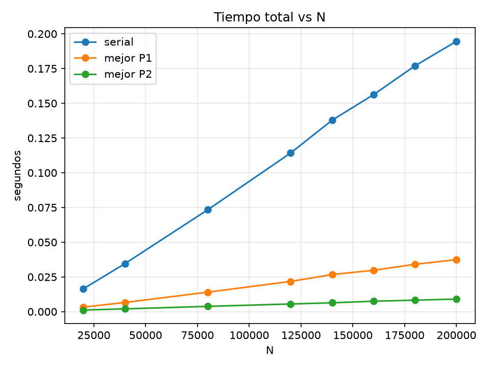
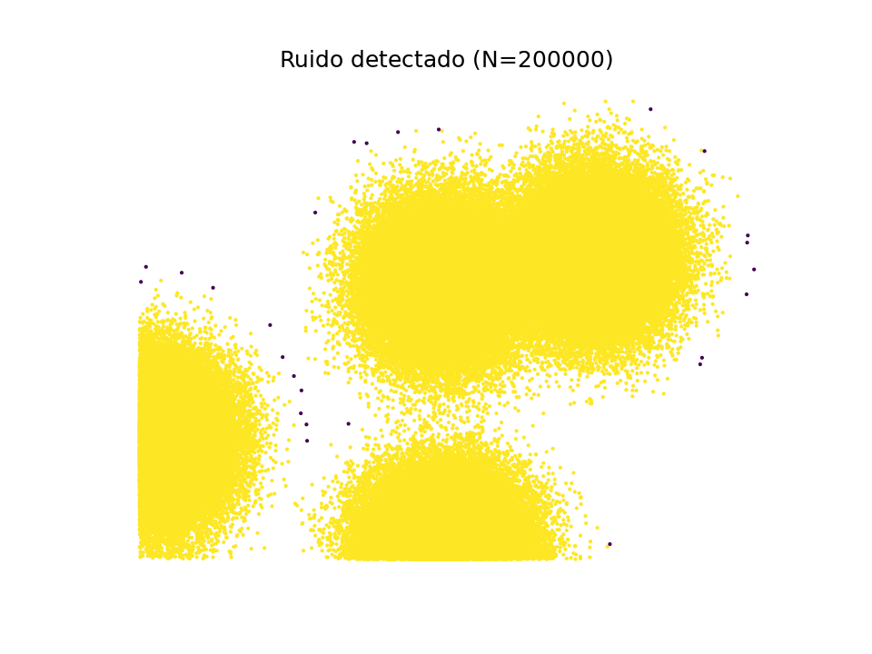

# DBSCAN paralelo para la detección de ruido con OpenMP

**Cómputo Paralelo y en la Nube — Proyecto de Apertura 2026b**
Integrantes: _[completar]_ · Fecha de entrega: 20 de octubre de 2026

---

## 1. Problema

DBSCAN clasifica cada punto según dos parámetros: `eps` (radio) y `min_samples` (vecinos mínimos para ser denso). Para detectar ruido basta el algoritmo "ingenuo" de dos pasos de la presentación:

| Estado | Definición |
|---|---|
| **Core (1er grado)** | tiene al menos `min_samples` vecinos a distancia ≤ ε |
| **Core (2º grado)** | no es core, pero tiene al menos un vecino core a distancia ≤ ε |
| **Ruido / outlier** | no es core y no tiene ningún vecino core a distancia ≤ ε |

- **Fase 1:** decide para cada punto si es core.
- **Fase 2:** para los que no lo son, decide si son core de 2º grado o ruido.

La Fase 2 **depende de que la Fase 1 esté completa para todos los puntos**, así que entre las dos fases debe haber una barrera.

Parámetros usados: `eps = 0.03` y `min_samples = 10`, los mismos que el notebook `DBSCAN_noise.ipynb`. Un punto **no** se cuenta a sí mismo como vecino.

## 2. Descripción del código

| Archivo | Función |
|---|---|
| [dbscan.cpp](dbscan.cpp) | Versión serial, P1 y P2 en un solo programa, más la medición de tiempo y la E/S |
| [Makefile](Makefile) | Compila con `g++-16 -O2 -fopenmp` |
| [generar_datos.py](generar_datos.py) | Genera `data/{N}_data.csv` con el mismo `make_blobs` del notebook del curso |
| [check.py](check.py) | Prueba de corrección: serial = P1 = P2 (todos los k) = sklearn |
| [experimentos.py](experimentos.py) | Ejecuta la rejilla completa de experimentos y escribe [resultados.csv](resultados.csv) |
| [graficas.py](graficas.py) | Genera las gráficas en `graficas/` |

**Uso del programa:**

```
./dbscan <entrada.csv> <salida.csv> <serial|p1|p2> <hilos> [k=4] [eps=0.03] [min_samples=10] [reps=1]
```

- **Entrada:** CSV `x,y` generado por el notebook o por `generar_datos.py`.
- **Salida:** CSV `x,y,etiqueta`, con etiqueta 1 = core (de 1er o 2º grado) y 0 = ruido. Es la misma convención que usa el notebook para graficar el resultado de sklearn, así que la segunda celda de `DBSCAN_noise.ipynb` lo visualiza directamente.
- **stdout:** una línea `modo,N,hilos,k,t_pre,t_alg,t_total` con el promedio de `reps` iteraciones, medido con `omp_get_wtime()` y sin contar la lectura ni la escritura de archivos.

### Estructuras de datos

- **Coordenadas** en dos arreglos separados `x[]` y `y[]` (estructura de arreglos), para que el acceso sea secuencial y aproveche la caché.
- **`es_core[]` y `estado[]`** son `unsigned char`, un byte por punto. No se usa `vector<bool>`, porque guarda bits empaquetados: dos hilos que escriben bits del mismo byte provocarían una condición de carrera.
- **Distancia al cuadrado** (`dist2`) comparada contra `eps²`, para no calcular `sqrt`.
- **`double` en lugar de `float`.** Las coordenadas tienen 3 decimales y ε = 0.03, así que muchas distancias caen *exactamente* en ε. Con `float`, el redondeo podría clasificar esos casos frontera distinto que la referencia (sklearn, que trabaja en `double`); por eso se eligió `double` de forma preventiva. La memoria extra es irrelevante: 3.2 MB con N = 200 000.
- **Sin matriz de adyacencia:** con N = 200 000 serían 4×10¹⁰ entradas. Las distancias se recalculan cuando se necesitan.

### Versión serial (línea base)

Es el mismo código de P1 sin los `#pragma omp`. Así se compara contra un serial "limpio", sin ningún overhead de OpenMP.

**Optimización compartida por las tres versiones (salida temprana):**
- En la Fase 1, el recorrido de vecinos se detiene (`break`) en cuanto se llega a `min_samples`: solo importa saber si se alcanzó el mínimo, no el conteo exacto.
- En la Fase 2, se detiene en el primer vecino core encontrado.

## 3. Estrategias de paralelización

### P1: espacio indivisible

Todos los puntos forman un solo conjunto y cada hilo puede leerlos todos. **La unidad de trabajo es el punto**, y los N puntos se reparten entre los hilos:

```c
#pragma omp parallel for schedule(dynamic, 64)   // Fase 1: ¿es core?
for (i = 0; i < N; i++) { ... es_core[i] = ...; estado[i] = ...; }
// barrera implícita al terminar el parallel for
#pragma omp parallel for schedule(dynamic, 64)   // Fase 2: ¿ruido o core de 2º grado?
for (i = 0; i < N; i++) { if (estado[i] != POSIBLE_RUIDO) continue; ... }
```

- **Sin condiciones de carrera:** cada hilo escribe solo `es_core[i]` y `estado[i]` de su propio `i`. En la Fase 2, `es_core[]` solo se lee.
- **Sincronización:** basta la barrera implícita al final del primer `parallel for`; ningún hilo empieza la Fase 2 hasta que la Fase 1 terminó para todos los puntos.
- **`schedule(dynamic, 64)`:** el costo por punto varía mucho. Un punto en zona densa termina tras pocas comparaciones; un punto de ruido recorre los N puntos. Con bloques dinámicos de 64 puntos, los hilos que terminan antes toman más trabajo.

### P2: espacio dividido en k regiones

El espacio se corta en una cuadrícula `gx × gy = k` lo más cuadrada posible:

| k | 2 | 4 | 8 | 16 | 32 | 64 |
|---|---|---|---|---|---|---|
| gx × gy | 2×1 | 2×2 | 4×2 | 4×4 | 8×4 | 8×8 |

Para cada región `r` se construyen dos listas:

- **M (internos):** los puntos que pertenecen a `r`. Cada punto está en **exactamente una** M y solo esa región lo etiqueta.
- **B (halo):** los puntos de otras regiones que caen en `r` ampliada ε hacia cada lado. **Solo se leen**: para calcular distancias y consultar `es_core`.

La construcción de M y B es un preprocesamiento serial y su tiempo (`t_pre`) se suma al tiempo de P2. Para que el redondeo en los límites de celda no deje fuera a un vecino situado *exactamente* a ε, el halo se amplía `eps·(1+10⁻⁹)`. Un halo más grande de lo necesario no cambia el resultado; solo añade unas pocas comparaciones.

**La unidad de trabajo es la región:**

```c
#pragma omp parallel for schedule(dynamic, 1)   // Fase 1 por región: es_core de los puntos de M usando M ∪ B
for (r = 0; r < k; r++) ...
// barrera implícita
#pragma omp parallel for schedule(dynamic, 1)   // Fase 2 por región: buscar vecino core en M ∪ B
for (r = 0; r < k; r++) ...
```

**¿Cómo se unen los resultados manteniendo la consistencia?** Es la pregunta de la presentación. Se resuelve con las dos fases separadas por una barrera:

- **Fase 1 (es local):** para saber si `i` es core solo hacen falta sus vecinos a distancia ≤ ε, y todos están en M ∪ B de su región. El conteo es exacto.
- **Fase 2 (no es local):** para saber si `i` es ruido hay que conocer el estado core de sus vecinos. Si un vecino está en el halo, su estado lo calcula *otra* región, y para ello necesita puntos que pueden estar hasta a 2ε de la frontera de la región de `i`. Por eso no se puede resolver localmente con un halo de ε.
- **Solución:** todas las regiones escriben `es_core[]` en un arreglo **global** durante la Fase 1. La barrera garantiza que ese arreglo está completo y es correcto antes de que cualquier región pase a la Fase 2.

**Sin condiciones de carrera:** cada punto pertenece a una sola M, así que un solo hilo escribe su estado. El halo solo se lee, y en la Fase 2 `es_core[]` ya no cambia.

**`schedule(dynamic, 1)`:** las regiones tienen densidades muy distintas (cúmulos vs. zonas vacías). Cada hilo toma una región nueva en cuanto se desocupa.

### Verificación de corrección

`check.py` genera N = 4 000 y N = 20 000 y comprueba:

1. **Serial = P1 = P2, punto por punto:** P1 con 1 y 8 hilos, y P2 con cada k ∈ {2, …, 64} con 1 y 8 hilos.
2. **Serial = `sklearn.cluster.DBSCAN`:** se compara el ruido (etiqueta −1) con `min_samples + 1`, porque sklearn cuenta al propio punto como vecino.

**Resultado: 0 diferencias en todos los casos.**

## 4. Evaluación experimental

### 4.1 Definición del experimento

| Parámetro | Valores |
|---|---|
| Versiones | serial, P1, P2 |
| k (solo P2) | 2, 4, 8, 16, 32, 64 |
| N (puntos) | 20 000, 40 000, 80 000, 120 000, 140 000, 160 000, 180 000, 200 000 |
| Hilos | 1, 4 (= vcores/2), 8 (= vcores), 16 (= 2·vcores) |
| Repeticiones | 10 por configuración, promediadas |
| eps, min_samples | 0.03, 10 |

- **Datos:** `make_blobs` con 4 centros, `cluster_std = 0.06`, `random_state = 11`, valores absolutos y 3 decimales, igual que el notebook del curso. Se generó un archivo por cada N.
- **Número de corridas:**
  - serial: 8 N
  - P1: 8 N × 4 hilos
  - P2: 8 N × 4 hilos × 6 k

  En total son 232 configuraciones × 10 repeticiones.
- **Qué se mide:** el tiempo del algoritmo, sin E/S. Para P2 el tiempo total incluye la construcción de regiones y halos (`t_total = t_pre + t_alg`).
- **Speedup:**

$$\text{speedup} = \frac{T_\text{serial}(N)}{T_\text{total}(\text{configuración}, N)}$$

- **Reproducción:**

```bash
python3 -m venv .venv && .venv/bin/pip install -r requirements.txt
make
.venv/bin/python generar_datos.py
.venv/bin/python check.py
.venv/bin/python experimentos.py
.venv/bin/python graficas.py
```

Los datos crudos están en [resultados.csv](resultados.csv).

### 4.2 Equipo

| | |
|---|---|
| Equipo | Apple MacBook con chip **Apple M2** |
| CPU | 8 cores: **4 de rendimiento (P) + 4 de eficiencia (E)**, sin SMT, así que 8 cores virtuales |
| Memoria | 8 GB unificada |
| Sistema operativo | macOS 27.0.1 |
| Compilador | GCC 16.2.0 (Homebrew), `-O2 -fopenmp`, runtime libgomp |
| Python (datos y gráficas) | Python 3.14.7, scikit-learn 1.9.1, NumPy, Matplotlib |

### 4.3 Resultados

**Tiempo serial:**

| N | 20k | 40k | 80k | 120k | 140k | 160k | 180k | 200k |
|---|---|---|---|---|---|---|---|---|
| T_serial (ms) | 16.5 | 34.5 | 73.4 | 114.2 | 137.8 | 156.2 | 177.0 | 194.6 |

**Speedup de P1:**

| Hilos \ N | 20k | 40k | 80k | 120k | 140k | 160k | 180k | 200k |
|---|---|---|---|---|---|---|---|---|
| 1 | 0.98 | 0.99 | 1.00 | 1.00 | 1.01 | 1.00 | 1.00 | 1.00 |
| 4 | 3.62 | 3.69 | 3.68 | 3.72 | 3.71 | 3.68 | 3.67 | 3.65 |
| 8 | 5.05 | 5.23 | 5.23 | 5.24 | 5.16 | 5.25 | 5.03 | 5.18 |
| 16 | 5.04 | 5.06 | 5.22 | 5.24 | 5.15 | 5.22 | 5.19 | 5.20 |

**Speedup de P2 con N = 200 000:**

| k \ Hilos | 1 | 4 | 8 | 16 |
|---|---|---|---|---|
| 2 | 1.38 | 2.61 | 2.60 | 2.60 |
| 4 | 1.99 | 4.36 | 4.37 | 4.37 |
| 8 | 2.87 | 7.22 | 8.80 | 8.16 |
| 16 | 4.18 | 10.21 | 11.98 | 12.12 |
| 32 | 5.94 | 16.55 | 18.29 | 19.21 |
| 64 | 7.53 | 18.50 | **21.53** | 21.51 |

**Desglose de P2 con N = 200 000 y 8 hilos:**

| k | 2 | 4 | 8 | 16 | 32 | 64 |
|---|---|---|---|---|---|---|
| t_pre (ms, serial) | 2.19 | 2.45 | 2.77 | 3.44 | 3.86 | 4.82 |
| t_alg (ms) | 72.64 | 42.09 | 19.35 | 12.81 | 6.78 | 4.22 |
| % del tiempo en preprocesamiento | 3 % | 6 % | 13 % | 21 % | 36 % | **53 %** |

**El requisito de speedup > 1.5 se cumple con holgura:**
- P1 llega a ≈ 5.2.
- P2 llega a ≈ 21.6; el máximo (21.65) es con N = 140 000, 8 hilos y k = 64.

### 4.4 Gráficas







Además están `graficas/speedup_p2_vs_N_{1,4,16}hilos.png`, con el speedup de P2 vs N para los demás números de hilos.

## 5. Interpretación y análisis

### 5.1 El costo real no es O(N²)

En el peor caso cada punto se compara con los N puntos. Pero el tiempo serial crece de forma **casi lineal**: 10× más puntos cuesta 11.8× más tiempo.

**Causa: la salida temprana.**
- Un punto core deja de buscar tras encontrar 10 vecinos. Si una fracción *p* de los puntos está a ≤ ε de él, recorre en promedio ≈ 10/*p* puntos, y ese número **no depende de N**, porque la densidad relativa de los cúmulos se mantiene.
- Solo los puntos de ruido recorren los N puntos, y son muy pocos: 26 de 200 000.

Por eso los tiempos absolutos son de milisegundos. Este dato es importante para interpretar el resto: el costo de cada punto depende mucho de **dónde está** el punto y de **en qué orden** se recorren sus candidatos.

### 5.2 P1: escala con los cores físicos y se satura en ~5.2×

- **1 hilo ≈ 1.00:** el overhead de OpenMP (crear el equipo de hilos, el planificador dinámico) es despreciable.
- **4 hilos ≈ 3.7:** eficiencia del 92 %. El sistema operativo asigna los hilos a los 4 cores P.
- **8 hilos ≈ 5.2, no 8:** el M2 tiene **4 cores P y 4 cores E**, y los E son bastante más lentos. Con 8 hilos se suma trabajo de cores más débiles. Una cota aproximada sería 4 + 4·(velocidad E/P) ≈ 5–6, que coincide con lo medido. `schedule(dynamic)` es lo que permite aprovecharlos: un reparto estático dejaría a los cores P esperando a los E.
- **16 hilos ≈ 8 hilos:** el M2 no tiene SMT. Con 2 hilos por core solo se alternan en el mismo hardware; no hay ganancia y tampoco pérdida apreciable.
- **El speedup casi no cambia con N:** P1 tiene N tareas pequeñas y el balance de carga es bueno para cualquier tamaño.

### 5.3 P2: gana por hacer menos trabajo, no solo por usar más hilos

- **Con 1 hilo, P2 ya es más rápido que el serial:** 1.38× con k = 2 y 7.5× con k = 64. Esto no es paralelismo, es **reducción de trabajo y localidad**:
  - Un punto de la región `r` busca vecinos solo en M ∪ B, una lista de puntos **cercanos a él**. La fracción *p* de vecinos válidos dentro de esa lista es mucho mayor, así que encuentra sus 10 vecinos tras muchas menos comparaciones.
  - Los pocos puntos de ruido recorren |M| + |B| ≈ N/k puntos en vez de N.
  - Las listas son más pequeñas y caben mejor en caché.
- **k < hilos deja hilos ociosos:** con k = 2 el speedup se estanca en 2.6 sin importar si hay 4, 8 o 16 hilos, porque solo hay 2 tareas. Con k = 4 se estanca en ≈ 4.4. Es la limitación prevista en la especificación.
- **k ≥ hilos:** con k = 8 y 8 hilos ya hay una tarea por hilo, pero la carga no está balanceada: las regiones que cubren los cúmulos densos cuestan mucho más que las vacías. Con k = 32 o 64 hay varias regiones por hilo y `dynamic, 1` reparte mucho mejor. Por eso el speedup sigue subiendo.
- **El límite de P2 es la ley de Amdahl:** la construcción de regiones es serial y su costo crece con k, porque hay más puntos repetidos en halos y más celdas por punto.
  - Con k = 64 y 8 hilos, el preprocesamiento ya es el **53 %** del tiempo total.
  - Por eso pasar de 4 a 8 hilos con k = 64 solo mejora de 18.5 a 21.5.
  - Por la misma razón, k = 64 casi no supera a k = 32 con 16 hilos (21.5 vs 19.2): el k óptimo está cerca del máximo probado y seguir aumentando k ya casi no aporta.
- **En N pequeño P2 gana menos:** con N = 20 000 el speedup es 14.3, frente a 21.5 con N = 200 000. Con pocos puntos, las regiones tienen pocos puntos, el halo pesa proporcionalmente más y el costo fijo del preprocesamiento domina.

### 5.4 ¿Por qué P2 es mejor que P1?

| | P1 | P2 (k = 64) |
|---|---|---|
| Speedup máximo (N = 200k) | 5.2 | 21.5 |
| Comparaciones por punto | Contra todo el conjunto | Solo contra M ∪ B (vecinos cercanos) |
| Balance de carga | Excelente (N tareas) | Bueno solo si k ≫ hilos |
| Parte serial | Ninguna | Construcción de regiones (hasta el 53 % del tiempo) |
| Límite principal | Número y tipo de cores (4P + 4E) | Preprocesamiento serial (Amdahl) |

- **P2 es claramente mejor en este problema, porque reduce el trabajo total.** P1 solo *reparte* el mismo trabajo del serial, así que su speedup está acotado por la capacidad de cómputo del equipo (≈ 5.2× en el M2). P2 hace muchas menos comparaciones gracias a la división espacial y al halo. Su speedup (21.5×) combina la reducción de trabajo (≈ 7.5×, la que ya se ve con 1 hilo) con el paralelismo (≈ 2.9× más con 8 hilos).
- **P1 sigue teniendo ventajas:** no necesita preprocesamiento ni memoria extra, es más simple de razonar y escala de forma predecible con cualquier N. **P1 sería competitivo** solo si k fuera pequeño frente al número de hilos o si las regiones estuvieran muy desbalanceadas.
- **Mejoras posibles para P2 (no implementadas):**
  - paralelizar la construcción de regiones, que es su cuello de botella
  - usar un k mayor que 64 cuando N crece

## 6. Uso responsable y ético de IA generativa

Este proyecto se realizó siguiendo los lineamientos de **IEEE** y **Elsevier** sobre el uso de IA generativa:

- **Divulgación.** Se usó **Claude (Anthropic, modelo Claude Opus 5.5) a través de Claude Code** para:
  - partir del documento de especificaciones de paralelización escrito por el equipo y de la presentación del proyecto, y escribir a partir de ellos el código (`dbscan.cpp` y los scripts de Python)
  - automatizar la ejecución de los experimentos
  - redactar un borrador de este reporte

  _[Completar: qué partes escribió el equipo, qué partes generó la herramienta y qué se modificó después.]_
- **Responsabilidad humana.** La IA no es autora del trabajo. Los integrantes del equipo son responsables de todo el contenido entregado. Como indica la presentación, el uso de un LLM no exime de entender al 100 % el código: _[confirmar que cada integrante revisó y puede explicar cada sección de `dbscan.cpp`, en particular las dos fases, la barrera, el halo y la ausencia de condiciones de carrera]_.
- **Verificación.** Lo generado no se aceptó sin comprobarlo:
  - La corrección se validó contra una implementación de referencia independiente (scikit-learn) y entre las tres versiones (`check.py`, 0 diferencias).
  - Los números de este reporte salen de `resultados.csv`, que se puede reproducir con los comandos de la sección 4.1.
  - Durante el desarrollo se detectó y corrigió un error en el script de generación de datos (sin argumentos no generaba ningún archivo). Además, se usó `double` y se amplió ligeramente el halo para prevenir errores de redondeo en distancias iguales a ε.
- **Datos y privacidad.** Los datos son sintéticos (generados con `make_blobs`). No se compartió información personal ni confidencial con la herramienta.
- **Fuentes:** [IEEE RAS — Guidelines for Generative AI Usage](https://www.ieee-ras.org/publications/guidelines-for-generative-ai-usage) · [Elsevier — Generative AI policies for journals](https://www.elsevier.com/about/policies-and-standards/generative-ai-policies-for-journals)
